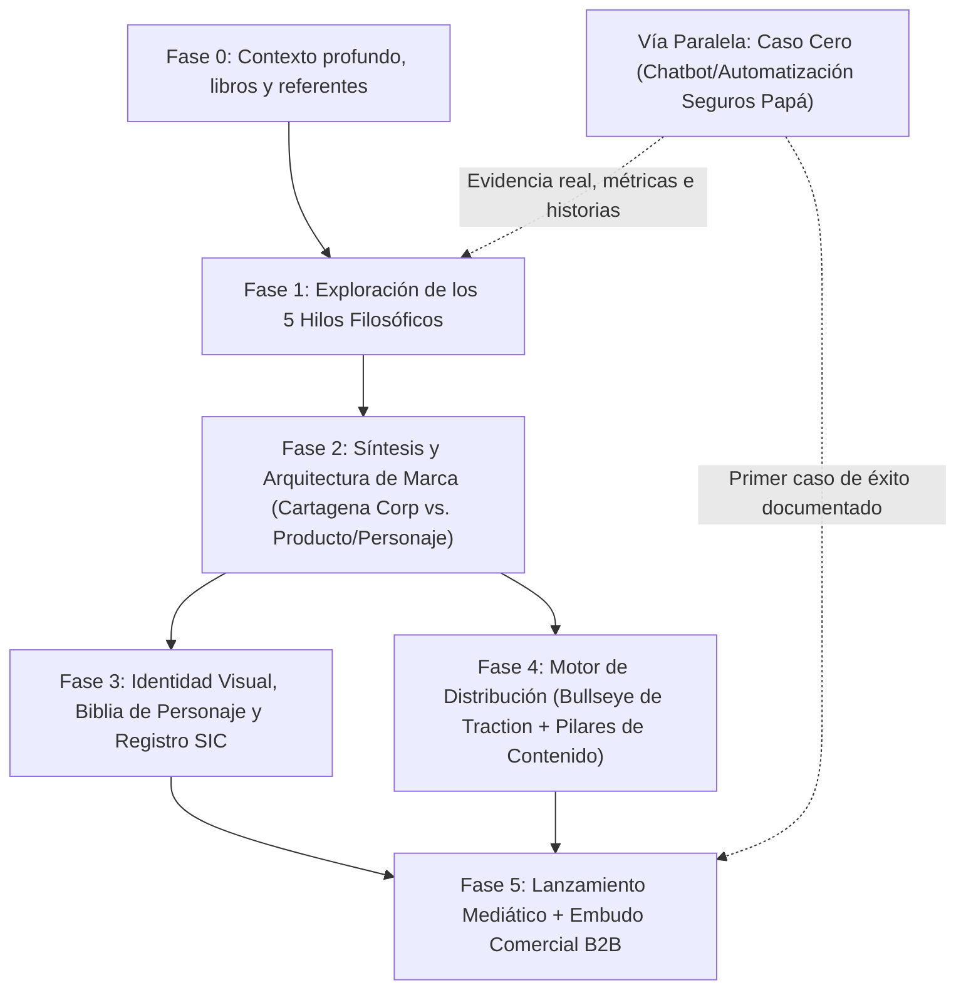

# Plan Maestro de Trabajo: De Cero a Marca Registrada y Motor de Ventas

Para evitar la trampa clásica del ingeniero emprendedor (pasar 6 meses diseñando logos antes de vender, o intentar vender en frío sin ninguna confianza de marca), trabajaremos con una metodología de **Doble Vía**: mientras construimos los cimientos de marca y propiedad intelectual, usamos tu entorno real como laboratorio comercial.

---

## Fase 0: Inmersión de Contexto y Referentes (Semana 1)
- Consolidar tu historia completa, el origen del nombre **Cartagena Corporation**, tus valores no negociables y tu visión del negocio.
- Integrar la lista de creadores de YouTube que te gustan, el video recomendado de 30X/Bilbao y los demás libros que tienes en casa para extraer principios accionables.
- **Entregable**: Carpeta `00-contexto/` completa.

## Fase 1: Laboratorio de las 5 Filosofías ("Los Hilos") (Semanas 1–2)
Exploraremos la creación de tu marca desde **5 escuelas mundiales distintas**. Para cada hilo:
1. Revisamos la tesis de esa escuela y sus referentes.
2. Respondes un cuestionario de 7–8 preguntas diseñado con la lógica exacta de esa filosofía.
3. Generamos un **prototipo completo de marca** (`ejercicio-marca.md`) como si fueras a seguir 100% esa línea.

Los 5 hilos son:
- **Hilo 1**: Valor Masivo y Prueba Empírica (*Hormozi / Caleb Ralston / 30X*).
- **Hilo 2**: Personaje Icónico y Narrativa (*StoryBrand / Juan Valdez / PostHog / Duolingo*).
- **Hilo 3**: Posicionamiento Radical B2B (*Marty Neumeier / April Dunford / Truora*).
- **Hilo 4**: Tribu, Comunidad y Distribución Primero (*Seth Godin / Traction / Greg Isenberg*).
- **Hilo 5**: Autoridad Ejecutiva Silenciosa (*Gergely Orosz / Patio11 / Chris Walker / Orosco*).

## Fase 2: Síntesis Estratégica y Arquitectura de Marca (Semana 3)
Comparamos los 5 prototipos y tomamos decisiones definitivas:
- **Arquitectura societaria vs. comercial**: ¿**Cartagena Corporation** será la marca visible (estilo *IBM / Stripe*) o el *holding* detrás de una marca/personaje más cercano y memorable (estilo *Federación → Juan Valdez* o *37signals → Basecamp*)?
- **Nivel exacto de exposición personal**: Definición del rol del fundador vs. el rol del personaje/mascota/narrador.
- **Tesis comercial inicial**: A quién le vendemos primero, qué problema resolvemos y cuál es la promesa central.
- **Entregable**: `03-sintesis-identidad/manifiesto-y-arquitectura.md`.

## Fase 3: Creación de Personaje, Logotipo y Blindaje Legal SIC (Semanas 3–4)
- **Biblia de Personaje / Mascota**: Personalidad, historia de origen, voz, muletillas, diseño visual consistente (poses, expresiones, estilo 2D/3D para animación ágil con IA o motion graphics).
- **Sistema Visual y Logotipo**: Paleta cromática, tipografía, isotipo/logotipo adaptable a web, software y redes.
- **Ruta Legal ante la SIC y DNDA (Colombia)**:
  - Búsqueda de antecedentes fonéticos y figurativos en SIPI.
  - Selección de Clases de Niza (ej. Clase 9 software descargable, Clase 35 gestión comercial/agencia, Clase 41 educación/contenido, Clase 42 SaaS y desarrollo de software).
  - Preparación de solicitud de marca nominativa/mixta/figurativa y registro de obra artística del personaje en la Dirección Nacional de Derecho de Autor (DNDA).
- **Entregable**: Carpetas `03-sintesis-identidad/` y `04-legal-sic-colombia/`.

## Fase 4: Diseño del Motor de Tracción (*Bullseye Framework*) (Semana 4)
Siguiendo el libro ***Traction***:
- Evaluamos los 19 canales de distribución aplicados a tu nicho.
- Seleccionamos **3 canales en el anillo medio** para hacer experimentos baratos y rápidos de 2 a 4 semanas (por ejemplo: *Contenido en Video con Personaje*, *Ingeniería como Marketing — micro-herramienta gratuita*, y *Ventas Directas apalancadas en Caso de Estudio*).
- Diseñamos el sistema de producción de contenido (guiones, voz, automatización visual) para que sea sostenible incluso mientras terminas tu migración en el banco.

## Fase 5: El "Caso Cero" y Proceso Comercial Repetible (Semanas 4–8)
- Ejecutar el piloto real (ej. el sistema/chatbot para la empresa de seguros de tu papá, cobrando o estructurándolo formalmente como contrato con métricas de antes/después: tiempo ahorrado, cotizaciones atendidas, pólizas cerradas).
- Convertir ese piloto en tu **activo estrella de ventas**: en vez de vender "sé programar cualquier cosa", vendes un resultado probado con números reales a otras 20 empresas idénticas.
